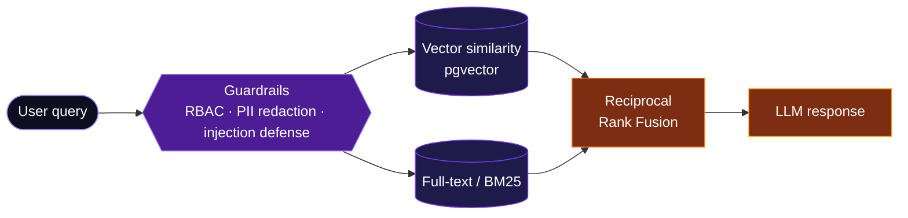
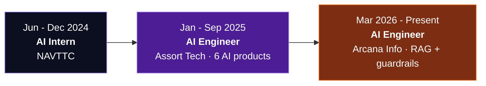

  

 

 

  

## About

Islamabad, Pakistan. Currently an **AI Engineer at Arcana Info** (since March 2026), building secure RAG backends for internal HR and travel-agent assistants. Before that I was an **AI Engineer at Assort Tech**, where I delivered 6 end-to-end AI products in 9 months. I'm exploring computer vision, MLOps and cloud-based AI deployment.

<table>
<tr>
<td width="25%" valign="top"><b>🔎 Retrieval &amp; RAG</b>  Hybrid search that combines vector similarity with BM25 / full-text, merged with Reciprocal Rank Fusion.</td>
<td width="25%" valign="top"><b>🛡️ LLM Guardrails</b>  Layered RBAC, PII redaction and prompt-injection defense for enterprise chatbots.</td>
<td width="25%" valign="top"><b>🎙️ Agents &amp; Voice</b>  A voice scheduling agent, OCR-based assistants and a GitHub PR review bot, delivered end to end.</td>
<td width="25%" valign="top"><b>⚙️ Production Backends</b>  FastAPI services hardened with JWT auth, rate limiting, request-ID middleware and structured error handling.</td>
</tr>
</table>

## Architecture I Work With

A simplified view of the hybrid-RAG-plus-guardrails pattern behind my production chatbots, not a literal system diagram.

## Tech Stack

  

<b>Full breakdown by domain</b>

 

| Domain | Technologies |
|:--|:--|
| **Languages & Frameworks** | Python · FastAPI · LangChain · LangGraph · HTML/CSS · Flutter |
| **LLMs & Retrieval** | OpenAI API · Gemini · Groq · Cohere · Ollama · RAG · hybrid search (vector + BM25 / full-text) · Prompt Engineering |
| **Machine Learning** | TensorFlow · Keras · Scikit-learn · PyTorch · YOLO |
| **Data & Infrastructure** | PostgreSQL · pgvector · MongoDB · SQL · Redis · Prisma · Supabase · Docker · Git · Linux |
| **Automation & Tooling** | n8n · Playwright |

## Featured Work

<table>
<tr>
<td width="50%" valign="top">

<h3>Arca AI · Secure HR Chatbot</h3>
<b>ARCANA INFO</b> · Company project (private)
  
Backend for an internal HR assistant. Retrieval combines <b>pgvector similarity</b> and <b>full-text search</b>, merged with <b>Reciprocal Rank Fusion</b>. A <b>3-layer guardrail system</b> (RBAC, PII redaction, prompt-injection defense) protects sensitive HR data, and <b>4 admin dashboard API modules</b> give the HR team live visibility into chatbot performance.
  
<code>FastAPI</code> <code>Prisma</code> <code>pgvector</code> <code>Groq</code> <code>Cohere</code>

</td>
<td width="50%" valign="top">

<h3>TBB Travel Assistant</h3>
<b>ARCANA INFO</b> · Company project (private)
  
Production RAG system that gives travel agents real-time answers from FAQs and guides. It combines <b>vector similarity and BM25 search</b> on PostgreSQL with pgvector and Cohere embeddings. Both this and Arca AI were hardened with <b>JWT auth, request-ID middleware, rate limiting and structured error handling</b>.
  
<code>FastAPI</code> <code>PostgreSQL</code> <code>pgvector</code> <code>BM25</code> <code>Cohere</code>

</td>
</tr>
</table>

<h3 align="center">Shipped at Assort Tech · 2025</h3>

<table>
<tr>
<td width="50%" valign="top">
<b>🤖 Company AI Chatbot</b> 
Real-time chat widget grounded in company content, resolving customer queries without manual intervention. 
<code>RAG</code> <code>Web scraping</code> <code>GPT-4o-mini</code>
</td>
<td width="50%" valign="top">
<b>🎙️ Voice Scheduling Assistant</b> 
One conversational interface across Google Calendar, email and SMS, with real-time speech in and out. 
<code>OpenAI Agents SDK</code> <code>TTS/STT</code>
</td>
</tr>
<tr>
<td width="50%" valign="top">
<b>🔍 GitHub PR Review Bot</b> 
Webhook-based bot that posts automatic code feedback on every incoming pull request. 
<code>Gemini</code> <code>Webhooks</code>
</td>
<td width="50%" valign="top">
<b>🎧 News-to-Podcast Pipeline</b> 
Fetches stories, summarizes them and converts them to audio in one triggered pipeline. 
<code>SerpAPI</code> <code>GPT-4</code> <code>TTS</code>
</td>
</tr>
<tr>
<td width="50%" valign="top">
<b>📚 Educational AI Assistant</b> 
Processes academic documents and images, then generates summaries, quizzes and explanations. 
<code>Mathpix OCR</code> <code>GPT-4o-mini</code>
</td>
<td width="50%" valign="top">
<b>📖 AI Book Generation Workflow</b> 
A single pipeline covering chapter writing, cover design and editing. 
<code>n8n</code> <code>Supabase</code> <code>Gemini</code>
</td>
</tr>
</table>

Most of this work was built for employers and is not public.
 

## Career Path

🎓 BS Computer Science · Federal Urdu University of Arts, Science &amp; Technology · 2019 – 2024

## GitHub Analytics

 

 

<!-- Optional animated contribution snake. Enable only after adding the workflow from the setup notes:

-->

Much of my professional work lives in private company repositories, so public stats reflect only part of what I build.

 

### Building something with LLMs or RAG? Let's talk.

