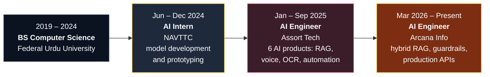

 

 

**AI Engineer at Arcana Info** (Islamabad). I build LLM-powered products end to end: RAG chatbots with hybrid search, voice agents, OCR-based assistants, GitHub bots and content-generation pipelines, all served through FastAPI backends and built with the security and production layers they need to run for real teams.

Before Arcana, I shipped 6 AI products in 9 months at Assort Tech, after an AI/ML internship at NAVTTC.

| | |
|:--|:--|
| **Role** | AI Engineer · LLM applications, RAG, agents, automation |
| **Delivered** | 6 AI products in 9 months · 2 production RAG systems at Arcana Info |
| **Also** | Applied ML and computer vision tooling: TensorFlow, Keras, scikit-learn, YOLO |
| **Exploring** | Computer vision, MLOps and cloud-based AI deployment |

---

## What I Build

<table>
<tr>
<td width="25%" valign="top"><b>RAG &amp; Retrieval</b>  Hybrid search that merges pgvector similarity with full-text / BM25 using Reciprocal Rank Fusion. Cohere embeddings on PostgreSQL.</td>
<td width="25%" valign="top"><b>Agents &amp; Voice</b>  A voice scheduling assistant that unifies Google Calendar, email and SMS with real-time TTS/STT, built on the OpenAI Agents SDK.</td>
<td width="25%" valign="top"><b>Document AI</b>  An OCR-based educational assistant: Mathpix OCR plus GPT-4o-mini to produce summaries, quizzes and explanations.</td>
<td width="25%" valign="top"><b>Workflow Automation</b>  A news-to-podcast pipeline and an n8n book-generation workflow covering writing, cover design and editing.</td>
</tr>
<tr>
<td width="25%" valign="top"><b>LLM Safety</b>  3-layer guardrails for an HR chatbot: RBAC, PII redaction and prompt-injection defense.</td>
<td width="25%" valign="top"><b>Backend &amp; APIs</b>  FastAPI and Prisma services with JWT auth, rate limiting, request-ID middleware, structured error handling and 4 admin dashboard modules.</td>
<td width="25%" valign="top"><b>Developer Tooling</b>  A webhook-based GitHub PR review bot on Gemini that gives feedback on 100% of incoming pull requests.</td>
<td width="25%" valign="top"><b>Applied ML</b>  Model development and prototyping from a 6-month AI/ML internship. Toolkit: TensorFlow, Keras, scikit-learn, YOLO.</td>
</tr>
</table>

---

## Career Trajectory

<b>AI Engineer · Arcana Info</b> &nbsp;Mar 2026 – Present · Islamabad

 

- Engineered a secure internal HR chatbot backend (Arca AI) on FastAPI and Prisma, built around a hybrid RAG pipeline: pgvector similarity plus full-text search, merged with Reciprocal Rank Fusion.
- Designed a 3-layer guardrail system (RBAC, PII redaction, prompt-injection defense) integrated with Groq and Cohere.
- Built 4 admin dashboard API modules: AI training progress, knowledge coverage, query resolution rate and announcement pulse.
- Developed the TBB Travel Assistant, a production RAG system for travel agents using vector similarity and BM25 on PostgreSQL + pgvector with Cohere embeddings.
- Diagnosed a cross-environment scraper failure (a subdomain mismatch across 2 staging environments) and restored Playwright-based content ingestion.
- Hardened both systems with structured error handling, JWT authentication, request-ID middleware and rate limiting.

<b>AI Engineer · Assort Tech</b> &nbsp;Jan 2025 – Sep 2025 · Lahore

 

- Delivered 6 end-to-end AI products in 9 months: RAG chatbots, voice agents, OCR-based assistants and content-generation pipelines.
- Built a company-specific RAG chatbot with web scraping and GPT-4o-mini, deployed as a real-time chat widget.
- Engineered a news pipeline (SerpAPI, GPT-4, text-to-speech) that condenses a multi-step manual workflow into one triggered pipeline.
- Built an educational assistant on Mathpix OCR and GPT-4o-mini, and a voice scheduling assistant on the OpenAI Agents SDK.
- Deployed a GitHub PR review bot on Gemini, and an n8n + Supabase + Gemini book-generation workflow.

<b>AI Intern · NAVTTC</b> &nbsp;Jun 2024 – Dec 2024 · Islamabad

 

Six-month AI/ML internship contributing to model development and prototyping across multiple project cycles, under senior engineer mentorship.

<b>Key achievements</b>

 

| | |
|:--|:--|
| **Hybrid retrieval architecture** | Combined 2 retrieval methods (vector similarity + BM25 / full-text) with Reciprocal Rank Fusion for the HR chatbot |
| **Production RAG pipeline** | Real-time FAQ and guide retrieval for travel agents on PostgreSQL + pgvector |
| **Multi-channel assistant** | Unified 3 channels (Calendar, email, SMS) in one conversational interface with real-time TTS/STT |
| **Faster code reviews** | AI-powered PR bot that cut review turnaround from hours to minutes |

---

## Architecture

A simplified overview of the kinds of systems I build. It combines patterns from several projects and is not a diagram of any single product.

```mermaid
flowchart LR
    subgraph IN["Inputs"]
        A1["Chat widget"]
        A2["Voice · STT"]
        A3["Documents · images"]
        A4["Webhooks · triggers"]
    end
    subgraph API["FastAPI backend"]
        B1["JWT auth · rate limiting<br/>request-ID · error handling"]
        B2["Guardrails<br/>RBAC · PII · injection defense"]
    end
    subgraph AI["AI layer"]
        C1["LLMs<br/>OpenAI · Gemini · Groq"]
        C2["Hybrid retrieval<br/>pgvector + BM25 + RRF"]
        C3["Agents<br/>OpenAI Agents SDK · LangGraph"]
    end
    subgraph OUT["Outputs"]
        D1["Answers · summaries · quizzes"]
        D2["Audio · TTS"]
        D3["PR feedback · dashboards"]
    end
    IN --> B1 --> B2 --> AI --> OUT

    style IN fill:#0B1220,stroke:#FBBF24,color:#fff
    style API fill:#0B1220,stroke:#FB7185,color:#fff
    style AI fill:#0B1220,stroke:#FBBF24,color:#fff
    style OUT fill:#0B1220,stroke:#FB7185,color:#fff
```

---

## Stack

<b>Full breakdown by domain</b>

 

| Domain | Technologies |
|:--|:--|
| **Languages & Frameworks** | Python · FastAPI · LangChain · LangGraph · HTML/CSS · Flutter |
| **LLMs & Retrieval** | OpenAI API · Gemini · Groq · Cohere · Ollama · RAG · hybrid search (vector + BM25 / full-text) · Prompt Engineering |
| **Agents & Voice** | OpenAI Agents SDK · real-time TTS / STT |
| **Document AI** | Mathpix OCR |
| **Machine Learning** | TensorFlow · Keras · scikit-learn · PyTorch · YOLO |
| **Data & Infrastructure** | PostgreSQL · pgvector · MongoDB · SQL · Redis · Prisma · Supabase · Docker · Git · Linux |
| **Automation & Tooling** | n8n · Playwright · SerpAPI |

---

## Project Explorer

Click a project to expand it. Most of this work was built for employers, so the code is private.

### At Arcana Info · 2026

<b>Arca AI</b> · secure HR chatbot backend

 

| | |
|:--|:--|
| **What it is** | Backend for an internal HR assistant |
| **Retrieval** | pgvector similarity + full-text search, merged with Reciprocal Rank Fusion |
| **Security** | 3-layer guardrails: RBAC, PII redaction, prompt-injection defense, integrated with Groq and Cohere |
| **Visibility** | 4 admin dashboard API modules: AI training progress, knowledge coverage, query resolution rate, announcement pulse |
| **Stack** | `FastAPI` `Prisma` `pgvector` `Groq` `Cohere` |
| **Code** | Company project, private |

<b>TBB Travel Assistant</b> · RAG for travel agents

 

| | |
|:--|:--|
| **What it is** | Production RAG system giving travel agents real-time answers from FAQs and guides |
| **Retrieval** | Vector similarity + BM25 search on PostgreSQL |
| **Stack** | `PostgreSQL` `pgvector` `Cohere embeddings` |
| **Also solved** | Traced a cross-environment scraper failure to a subdomain mismatch across 2 staging environments, restoring Playwright-based content ingestion |
| **Code** | Company project, private |

<b>Production hardening</b> · applied to both systems

 

Structured error handling, JWT authentication, request-ID middleware and rate limiting across all API endpoints of both systems.

### At Assort Tech · 2025

<b>Company AI chatbot</b> · real-time chat widget

 

RAG over company content, using web scraping and GPT-4o-mini, deployed as a chat widget that resolves customer queries without manual intervention.

`RAG` `Web scraping` `GPT-4o-mini`

<b>Voice scheduling assistant</b> · three channels, one interface

 

Unifies Google Calendar, email and SMS into one conversational interface with real-time speech-to-text and text-to-speech, built with the OpenAI Agents SDK.

`OpenAI Agents SDK` `TTS / STT`

<b>GitHub PR review bot</b> · automatic code feedback

 

A webhook-based bot using Gemini that generates code feedback on 100% of incoming pull requests, shortening manual review turnaround from hours to minutes.

`Gemini` `Webhooks`

<b>News-to-podcast pipeline</b>

 

Fetches stories via SerpAPI, summarizes them with GPT-4 and converts them to audio with text-to-speech, turning a multi-step manual workflow into a single triggered pipeline.

`SerpAPI` `GPT-4` `TTS`

<b>Educational AI assistant</b> · OCR-based

 

Uses Mathpix OCR to process academic documents and images, then generates summaries, quizzes and explanations with GPT-4o-mini.

`Mathpix OCR` `GPT-4o-mini`

<b>AI book-generation workflow</b>

 

An end-to-end pipeline covering chapter writing, cover design and editing.

`n8n` `Supabase` `Gemini`

### Personal repositories

[**FlutterResponsiveUI**](https://github.com/Naseem-tahir123/FlutterResponsiveUI) · Flutter, Dart &nbsp;·&nbsp; [All repositories](https://github.com/Naseem-tahir123?tab=repositories)

---

## Quick Answers

<b>What do you build?</b>

 

LLM-powered products end to end: RAG chatbots with hybrid search, voice agents, OCR-based assistants, GitHub bots and content-generation pipelines, usually behind a FastAPI backend.

<b>Is your work only RAG?</b>

 

No. RAG is one area. I have also built a voice scheduling agent, an OCR-based educational assistant, a GitHub PR review bot, a news-to-podcast pipeline and an n8n book-generation workflow, and I did model development and prototyping during my AI/ML internship.

<b>How do you improve retrieval quality?</b>

 

By combining two retrieval methods instead of relying on one: vector similarity (pgvector) plus full-text / BM25 search, merged with Reciprocal Rank Fusion.

<b>How do you secure an LLM app?</b>

 

With layers. For the HR chatbot I built a 3-layer guardrail system (RBAC, PII redaction, prompt-injection defense). On the API side I add JWT authentication, request-ID middleware, rate limiting and structured error handling.

<b>What are you working on right now?</b>

 

Since March 2026 at Arcana Info: Arca AI, a secure internal HR chatbot backend, and the TBB Travel Assistant, a RAG system for travel agents.

<b>What are you exploring next?</b>

 

Computer vision, MLOps and cloud-based AI deployment.

---

## GitHub Stats

Much of my professional work is in private company repositories, so public stats show only part of it.

---

## Contact

<!-- Add once you have the URL:

-->

Islamabad, Pakistan

