 

<a href="#ask-my-profile">Ask my profile</a> &nbsp;·&nbsp;
<a href="#stack">Stack</a> &nbsp;·&nbsp;
<a href="#project-explorer">Projects</a> &nbsp;·&nbsp;
<a href="#experience">Experience</a> &nbsp;·&nbsp;
<a href="#github-stats">Stats</a> &nbsp;·&nbsp;
<a href="#contact">Contact</a>

 

I build production LLM applications: **hybrid-search RAG pipelines**, **guardrailed enterprise chatbots**, and **voice and OCR-based AI assistants**, served through FastAPI backends. Currently an AI Engineer at **Arcana Info** in Islamabad.

---

## Ask my profile

Click a question to expand the answer.

<b><code>&gt; what do you build?</code></b>

 

Production LLM applications. That includes RAG chatbots with hybrid search, voice agents, OCR-based assistants and content-generation pipelines, usually with a FastAPI backend.

<b><code>&gt; what are you working on right now?</code></b>

 

Since March 2026 I have been an AI Engineer at **Arcana Info**, working on two systems: **Arca AI**, a secure internal HR chatbot backend, and the **TBB Travel Assistant**, a RAG system for travel agents.

<b><code>&gt; how do you improve retrieval quality?</code></b>

 

By combining two retrieval methods instead of relying on one. I pair **vector similarity (pgvector)** with **full-text / BM25 search** and merge the ranked results with **Reciprocal Rank Fusion**.

<b><code>&gt; how do you secure an LLM app?</code></b>

 

With layers. For the HR chatbot I built a **3-layer guardrail system**: role-based access control (RBAC), PII redaction and prompt-injection defense. On the API side I add JWT authentication, request-ID middleware, rate limiting and structured error handling.

<b><code>&gt; what have you shipped before?</code></b>

 

At Assort Tech (Jan – Sep 2025) I delivered **6 end-to-end AI products in 9 months**: a RAG chatbot widget, a voice scheduling assistant, a GitHub PR review bot, a news-to-podcast pipeline, an OCR-based educational assistant and an AI book-generation workflow. Details are in the [project explorer](#project-explorer).

<b><code>&gt; what are you exploring next?</code></b>

 

Computer vision, MLOps and cloud-based AI deployment.

---

## Stack

---

## Project Explorer

Click a project to expand it. Most of this work was built for employers, so the code is private.

### At Arcana Info · 2026

<b>Arca AI</b> · secure HR chatbot backend

 

| | |
|:--|:--|
| **What it is** | Backend for an internal HR assistant |
| **Retrieval** | pgvector similarity + full-text search, merged with Reciprocal Rank Fusion |
| **Security** | 3-layer guardrails: RBAC, PII redaction, prompt-injection defense, integrated with Groq and Cohere |
| **Visibility** | 4 admin dashboard API modules: AI training progress, knowledge coverage, query resolution rate, announcement pulse |
| **Stack** | `FastAPI` `Prisma` `pgvector` `Groq` `Cohere` |
| **Code** | Company project, private |

<b>TBB Travel Assistant</b> · RAG for travel agents

 

| | |
|:--|:--|
| **What it is** | Production RAG system giving travel agents real-time answers from FAQs and guides |
| **Retrieval** | Vector similarity + BM25 search on PostgreSQL |
| **Stack** | `PostgreSQL` `pgvector` `Cohere embeddings` |
| **Also solved** | Traced a cross-environment scraper failure to a subdomain mismatch across 2 staging environments, restoring Playwright-based content ingestion |
| **Code** | Company project, private |

<b>Production hardening</b> · applied to both systems

 

Structured error handling, JWT authentication, request-ID middleware and rate limiting across all API endpoints of both systems.

### At Assort Tech · 2025

<b>Company AI chatbot</b> · real-time chat widget

 

RAG over company content, using web scraping and GPT-4o-mini, deployed as a chat widget that resolves customer queries without manual intervention.

`RAG` `Web scraping` `GPT-4o-mini`

<b>Voice scheduling assistant</b> · three channels, one interface

 

Unifies Google Calendar, email and SMS into one conversational interface with real-time speech-to-text and text-to-speech, built with the OpenAI Agents SDK.

`OpenAI Agents SDK` `TTS / STT`

<b>GitHub PR review bot</b> · automatic code feedback

 

A webhook-based bot using Gemini that generates code feedback on every incoming pull request, shortening manual review turnaround from hours to minutes.

`Gemini` `Webhooks`

<b>News-to-podcast pipeline</b>

 

Fetches stories via SerpAPI, summarizes them with GPT-4 and converts them to audio with text-to-speech, turning a multi-step manual workflow into a single triggered pipeline.

`SerpAPI` `GPT-4` `TTS`

<b>Educational AI assistant</b> · OCR-based

 

Uses Mathpix OCR to process academic documents and images, then generates summaries, quizzes and explanations with GPT-4o-mini.

`Mathpix OCR` `GPT-4o-mini`

<b>AI book-generation workflow</b>

 

An end-to-end pipeline covering chapter writing, cover design and editing.

`n8n` `Supabase` `Gemini`

### Personal repositories

[**FlutterResponsiveUI**](https://github.com/Naseem-tahir123/FlutterResponsiveUI) · Flutter, Dart &nbsp;·&nbsp; [All repositories](https://github.com/Naseem-tahir123?tab=repositories)

---

## Experience

<b>AI Engineer · Arcana Info</b> &nbsp;Mar 2026 – Present · Islamabad

 

Hybrid RAG systems, layered LLM guardrails and production hardening for enterprise chatbots.

<b>AI Engineer · Assort Tech</b> &nbsp;Jan 2025 – Sep 2025 · Lahore

 

Delivered 6 end-to-end AI products over 9 months: RAG chatbots, voice agents, OCR-based assistants and content-generation pipelines.

<b>AI Intern · NAVTTC</b> &nbsp;Jun 2024 – Dec 2024 · Islamabad

 

Six-month AI/ML internship covering model development and prototyping under senior engineer mentorship.

<b>Education</b> &nbsp;2019 – 2024

 

BS Computer Science, Federal Urdu University of Arts, Science & Technology, Islamabad.

---

## GitHub Stats

<b>Live stats</b>

 

Much of my professional work is in private company repositories, so public stats show only part of it.

---

## Contact

<!-- Add once you have the URL:

-->

Islamabad, Pakistan

